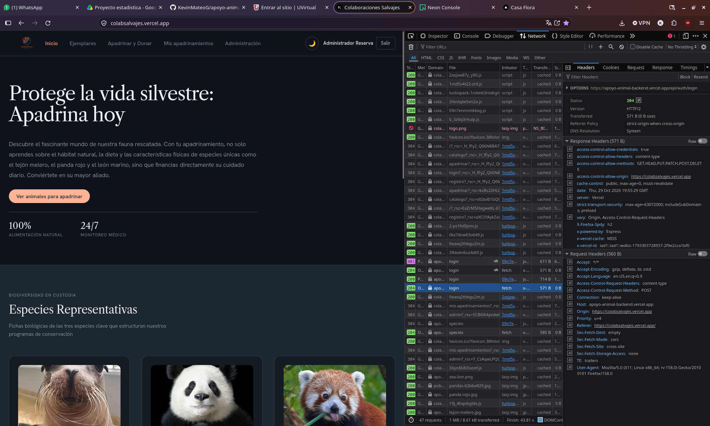
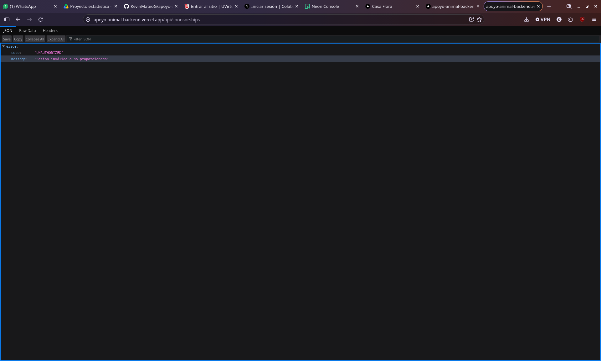

# apoyo-animal-frontend

Este proyecto es el frontend de **Colaboraciones Salvajes**, una plataforma web desarrollada en Next.js, TypeScript y Tailwind CSS para consultar el catalogo de especies y ejemplares de la reserva, registrar apadrinamientos o donaciones y administrar el catalogo segun el rol del usuario.

### Link frontend: <a href="https://colabsalvajes.vercel.app/">Pagina principal frontend</a>
### Link backend: <a href="https://apoyo-animal-backend.vercel.app/">Pagina principal backend</a>

### ¿Como correrlo en local?
Para correr el frontend en local, primero debes de clonar el repositorio:
```
git clone https://github.com/KevinMateoG/apoyo-animal.git
```

Despues de clonar el repositorio debes de instalar las dependencias:
```
npm install
```

Para correr el frontend en local debemos de crear un archivo `.env` en la raiz del proyecto y agregar la siguiente variable de entorno apuntando a la URL donde corre el backend:
```
NEXT_PUBLIC_API_HOST=http://localhost:3000
```
Esta variable de entorno es necesaria para que el frontend pueda comunicarse con la API del backend. Tambien puedes usar el archivo `.env.example` como referencia para crear tu archivo `.env` y remplazar el valor con la URL de tu backend en local o en produccion.

Ahora para correr el frontend se debe ejecutar el siguiente comando:
```
npm run dev
```

Aqui el frontend correra por defecto en el puerto `5173` (`http://localhost:5173`).

### Credenciales de prueba para el login:
- Admin:
  - email: admin@apoyoanimal.org
  - password: Admin1234!

- Usuario:
  - email: usuario@apoyoanimal.org
  - password: Usuario1234!

### Desiciones tecnicas:
- **Expliacion del flujo de un login:**
  El usuario comienza llenando el formulario en `/login`, el cual envia una peticion POST a la ruta `/api/auth/login` con su email y password por medio del servicio de autenticacion, el backend valida que el usuario exista en la base de datos y que la contraseña sea correcta, si es correcto, el backend genera un token de sesion y lo envia junto con los datos del usuario (incluyendo su rol `user` o `admin`) al frontend, el frontend guarda el token en el `localStorage` y el cliente HTTP centralizado (`http.ts`) lo agrega automaticamente en el header `Authorization: Bearer <token>` en cada peticion que se haga al backend, el backend valida el token y si es valido permite el acceso a la ruta protegida que se solicito (como `/mis-apadrinamientos` o `/admin`), si no es valido o expira y el backend responde con un error `401 Unauthorized`, el cliente HTTP limpia la sesion y redirige al usuario a `/login`.

- **¿Dónde guardas el token en el frontend y qué riesgo tiene esa decisión?:**
  El token se guarda en el `localStorage` del navegador para mantener la sesion activa al refrescar la pagina, esto tiene un riesgo de seguridad (XSS) ya que si un atacante logra ejecutar un script malicioso en el navegador del usuario, este podria acceder al `localStorage` y obtener el token, con esto podria hacerse pasar por el usuario y acceder a las rutas protegidas del backend, para mitigar este riesgo se puede implementar un sistema de cookies `HttpOnly` junto con un refresh token, donde el token de acceso tenga una vida corta y el refresh token tenga una vida larga, de esta manera si el token de acceso expira el frontend puede solicitar uno nuevo sin exponer la credencial principal a scripts del navegador.

- **¿En qué caso tu API responde 401 y en cuál 403? Da un ejemplo real de tu proyecto.**

  - 401 Unauthorized: Este error se responde cuando el usuario no esta autenticado, es decir, no tiene un token valido o no envio el token en la peticion. Por ejemplo, si un usuario sin iniciar sesion intenta consultar sus apadrinamientos en `/api/sponsorships/mias` o crear un apadrinamiento en `/api/sponsorships` sin enviar un token en la peticion, el backend respondera con un error 401 Unauthorized.
  
  - 403 Forbidden: Este error se responde cuando el usuario esta autenticado pero no tiene permisos para acceder a la ruta solicitada. Por ejemplo, si un usuario con rol de `user` intenta eliminar un ejemplar en `DELETE /api/animals/:id` o listar todos los apadrinamientos en `GET /api/sponsorships` que solo son accesibles para usuarios con rol de `admin`, el backend respondera con un error 403 Forbidden.

- **Si usaste IA, ¿para qué la usaste y qué tuviste que corregir?**
  Principalmente use IA para organizar la migracion de los componentes a la estructura por features (`common`, `auth`, `catalogo`, `interaccion`) y conectar el cliente HTTP centralizado con el backend, tambien me ayudo a implementar el selector de subida de archivos en el panel de administracion para enviar las imagenes en base64 hacia el endpoint de storage en Neon Object Storage, y tuve que corregir algunos detalles de los hooks con `useEffect` para evitar errores del linter de React y ajustar las configuraciones de variables de entorno e imagenes remotas en `next.config.ts` para el despliegue en Vercel.

- **captura de la pestaña Network:**
Aqui observamos la pestaña Network de la aplicacion, donde vemos una peticion GET a `/api/sponsorships` que es exclusiva de admin.




Si hacemos la peticion sin el token de autenticacion, el backend responde con un error 401 Unauthorized, ya que el usuario no esta autenticado.


